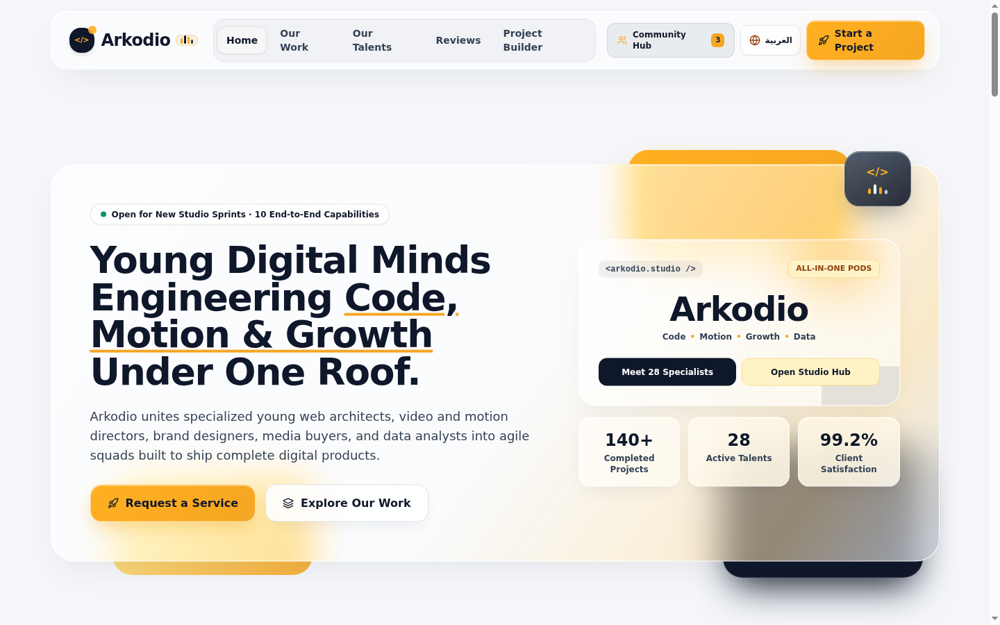

# Arkodio — Next-Generation Digital Creative & Tech Studio



> **Arkodio** is a premium, high-converting bilingual (Arabic RTL / English LTR) web application for a next-generation digital creative & tech studio powered by top young talents offering end-to-end online services.

---

## ✨ Features & Architecture

- **Aesthetic**: Premium Frosted Glassmorphism meets Modern Bento Grid UI, geometric minimalism, and fluid ambient warm amber (#F5A623 / #FFB020) & deep midnight navy (#0F172A) gradients.
- **Bilingual Engine**: Seamless toggle between English (LTR) and Arabic (RTL) with dynamic `dir="rtl"` / `dir="ltr"` switching, localized typography (`Cairo` / `IBM Plex Sans Arabic` and `Plus Jakarta Sans` / `Space Grotesk`), and persistent state.
- **6 Full Interactive Pages**:
  1. **Home (`#/`)**: Frosted glass hero centerpiece floating over geometric shapes, interactive 10-capability Services Bento Grid, hover-preview featured work, 3D Why Arkodio cards, infinite pausable reviews marquee.
  2. **Our Work / Portfolio (`#/work`)**: Category-filtered gallery + search + interactive case study modal with squad member links, challenge/solution, and deliverables.
  3. **Our Talents / Team (`#/talents`)**: Interactive department tabs, availability toggle, 3D tilt glass cards with verified project counts and deep-links to featured studio builds.
  4. **Arkodio Hub (`#/hub`)**: Live Idea & Collaboration Wall (post, vote, comment), Open Squad Bounties board, and "Join the Roster" talent pitch application.
  5. **Reviews & Client Wall (`#/reviews`)**: 4.9/5 rating analytics, Before & After metrics grid, categorized feedback filter, and interactive "Submit Your Review" client form.
  6. **Smart Contact & Project Builder (`#/contact`)**: Interactive 3-step project estimator with live scope blueprint calculation (service combination, timeline, squad roster, investment estimate), direct contact cards, and studio FAQ accordion.

---

## 🛠 Tech Stack

- **Framework**: React 18
- **Language**: TypeScript
- **Styling**: Tailwind CSS + PostCSS + Custom Frosted Glassmorphism & Bento CSS Tokens
- **Animations**: Framer Motion (3D tilt glass cards, spring animations, smooth route transitions)
- **Icons**: Lucide Icons
- **Bundler**: Vite 5 + vite-plugin-singlefile (supports standalone single-file builds)

---

## 🚀 Getting Started

### Prerequisites

- Node.js >= 18
- npm / pnpm / yarn

### Installation

```bash
git clone https://github.com/arkamrashed97/arkodio.git
cd arkodio
npm install
```

### Development

```bash
npm run dev
```

### Production Build

```bash
npm run build
```

The output will be in `dist/`.

### Standalone Single-File Build

To generate a single, self-contained HTML file (`dist-portable/index.html`):

```bash
npm run build:portable
```

---

## 📄 License

MIT © [Arkam Rashed](https://github.com/arkamrashed97)
